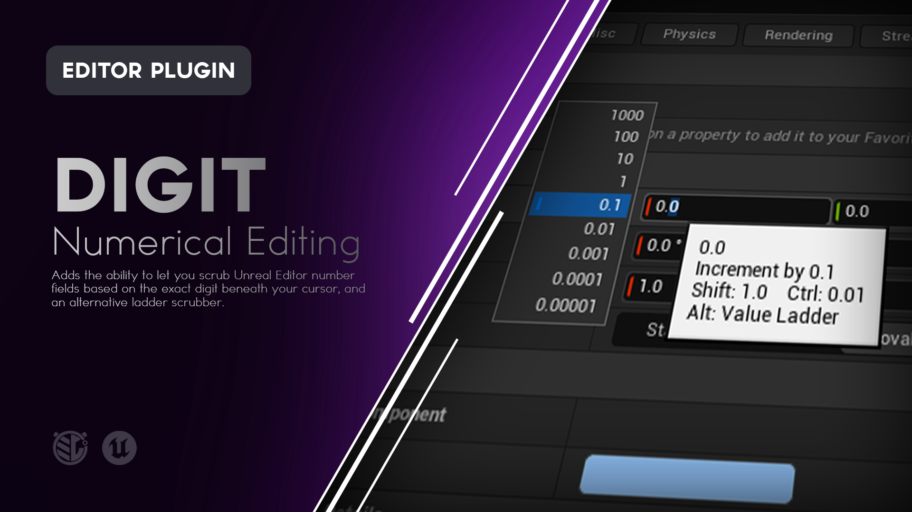

# Digit

**Digit-aware numeric scrubbing for Unreal Engine.**

Digit lets you scrub Unreal Editor number fields based on the exact digit beneath your cursor.

Hover the hundreds place to work in hundreds. Hover the tenths place to make fine decimal adjustments. Hold Alt to open a Value Ladder and change the active magnitude while you drag.




---

## What is Digit?

Unreal Engine already lets you scrub many numeric fields by dragging horizontally.

The problem is deciding **how much** that drag should change the value.

When working with:

```text
1234.567
```

you might want to adjust:

```text
1000s
100s
10s
1s
0.1s
0.01s
0.001s
```

Those are very different editing scales.

Digit makes the number itself the control.

Hover the digit representing the magnitude you want, then drag horizontally.

For example:

```text
1234.567
││││ │││
││││ ││└─ 0.001
││││ │└── 0.01
││││ └─── 0.1
│││└───── 1
││└────── 10
│└─────── 100
└──────── 1000
```

Hover the `2` and scrub in hundreds.

Hover the `4` and scrub in ones.

Hover the `6` and scrub in hundredths.

Digit gives precision control without adding another editing mode or replacing Unreal Engine's existing numeric fields.

---

## Features

### Digit-Aware Scrubbing

The exact digit beneath the cursor determines the magnitude of the numeric scrub.

### Per-Digit Highlighting

Digit highlights the individual numeric character currently targeted by the cursor.

### Place-Value Tooltips

Hover a digit to see:

- Current value
- Current increment
- Shift increment
- Ctrl increment
- Value Ladder shortcut

### Integer and Decimal Support

Work with whole-number and floating-point fields using the place values appropriate to each. Integer spin boxes use direct whole-number changes so targeting tens, hundreds, or larger places is not reduced to one-unit increments by the native slider fraction. The displayed numeric type is never changed.

### Continuous Rotation Scrubbing

Transform Rotation components use continuous angle scrubbing. Dragging through +180° or -180° wraps around, and reversing direction works immediately, even after several complete revolutions. Tenth-degree and finer adjustments use a compensated cursor-displacement accumulator to avoid producing hidden near-integer rounding residues in the Details panel. Legitimate fractional source values remain intact. Digit recognizes rotator components from the surrounding Slate widget hierarchy so other angle-valued scalar fields continue to observe their actual bounds.

### Shift for Coarser Control

Hold **Shift** while scrubbing to increase the adjustment magnitude.

### Ctrl for Finer Control

Hold **Ctrl** while scrubbing for finer adjustment.

### Alt Value Ladder

Hold **Alt** to display a vertical ladder of nearby numeric magnitudes.

While dragging, move vertically through the ladder to change the active magnitude without starting another interaction.

### Nine Ladder Magnitudes

The Value Ladder displays up to:

- 4 magnitudes above the targeted digit
- The original targeted magnitude
- 4 magnitudes below it

Integer fields automatically prevent fractional ladder values.

### Native Drag Threshold

Digit preserves Unreal Engine's normal drag threshold before numeric scrubbing begins.

A click still behaves like a click instead of immediately changing the value.

### Native Numeric Constraints

Digit works through Unreal Engine's supported numeric spin boxes, respecting their hard numeric limits, numeric types, native mouse capture, and editing callbacks. Floating-point linear/unbounded fields use digit-scaled native drag behavior. Integer fields, rotator components, and nonlinear bounded fields use direct numeric targets where native mouse-fraction calculations cannot express the intended change reliably. Rotator components wrap through the normalized angle range continuously in either direction. A zero-valued rotation still allows selecting its visible digits, because Digit knows rotator components store degrees even when the displayed zero cannot identify a unit by numerical conversion alone. Precision remains limited by the stored numeric type. When Digit temporarily substitutes a precise numeric value for a bound editor control, it restores the original binding with snapping temporarily disabled, then returns the control's original snapping increment. This avoids a second rounding step during native cleanup. For double-valued fields, the working snap grid respects displayed fractional digits beyond nine when the number type can represent them.

### Direction Feedback

While actively scrubbing, Digit outlines the numeric field to show whether the current movement is increasing or decreasing the value. The blue increase and orange decrease outlines use fixed colors.

### Scrub Sensitivity

Adjust horizontal scrub sensitivity from Project Settings to match your preferred mouse movement.

A value of `1.0` is the default. Lower values require more horizontal movement, while higher values require less.

### Ladder Magnitude Sensitivity

Adjust how much vertical mouse movement is required to change Value Ladder magnitudes.

A value of `1.0` is the default and is tuned for more deliberate rung changes. Lower values require more vertical movement, while higher values switch magnitudes more quickly.

### Native Mouse Capture and Interaction Cleanup

Digit uses Unreal Engine's native mouse capture, drag threshold, and numeric slider callbacks. It does not create separate editor transactions. A numeric field only begins adjusting after its native spin box captures the initiating mouse pointer.

If a click does not start a native slider interaction, or the numeric widget disappears during editing, Digit stops targeting that field and restores its temporary widget settings. On ordinary mouse release, it waits for native capture and deferred numeric commits to finish before restoring them. A new Digit interaction cannot begin while the preceding one is being cleaned up.

Pressing Escape during a captured drag remains an Unreal Engine action: Digit does not consume the key or replace the widget's native cancel handler. Undo and Redo are handled by the owning Unreal editor.

Depending on the editor context, the cursor may be hidden while the drag is active. Digit's targeted-digit highlight and increase/decrease outline provide direction feedback.

### Customizable Highlight

Configure the digit highlight background and highlighted text color from Project Settings.

### Editor-Wide Integration

Digit works with supported scrub-enabled Unreal Editor numeric spin boxes rather than being tied to one specific Details panel. This can include compatible scalar fields in Material Instances and Material Parameter Collections. Niagara inline float, integer, and vector inputs that expose native scrub-enabled spin boxes are eligible: their existing begin/change/end parameter callbacks remain in control. Niagara's verified standard parameter interfaces keep displayed and stored units identical, so digit targeting also works with an explicitly labeled value of zero, such as `0.00 cm`. This rule never applies to arbitrary converted-unit fields. Sequencer numeric key fields and Control Rig single-value numeric fields can also use compatible native spin boxes. Digit recognizes those specialized numeric owners to avoid overriding an independently refreshed host value with a stale direct-write target. During a captured drag it also pauses Digit-specific movement if the visible field switches to a non-scalar annotation, structured time, an ellipsis, a different visible decimal precision, or another display unit. Digit also checks a field's displayed unit/format and a specialized field's original bound source every captured Slate post-tick and immediately before native mouse-up. If the owning editor changed the value without another mouse movement, Digit restores that source before the native release callback can commit an obsolete direct-write target. If the displayed numeric format changes while the cursor is stationary, Digit suspends place-specific movement and clears temporary snapping for the native release. Delayed callbacks that merely echo Digit's own recent values are accepted. The owning editor retains its native mouse-up and transaction lifecycle. Native editors continue to own their transactions and commit behavior. The Curve Editor's key-detail panel uses property-backed fields for key Time and Value. Compatible numeric Value fields retain native commit callbacks. Curve Editor extension-tool numeric settings are also recognized as specialized, structure-backed Details fields, so independent source updates will not silently overwrite active direct-value scrubs. At zero, a key Time spin box is left to Unreal because its frame/tick/display-rate conversion cannot be established from a single displayed value. The standard frame-number Time customization actually uses a text editor rather than a numeric spin box; Digit does not intercept that control. Structured timecode (including drop-frame and subframe indicators) is excluded from decimal place-value targeting; its digits represent separate time components. Sequencer's generic Value Stepper may be backed by frames, seconds, or ticks, so Digit does not claim a zero-value mapping it cannot establish. Converted frame/second fields, Control Rig differing-value multi-edit annotations, non-spin Niagara controls, and editor-specific transaction behavior still require in-editor validation before claiming comprehensive coverage.

### International Number Formats

Digit reads the same localized number-formatting rules used by Unreal's numeric type interface when interpreting decimal and grouping separators, including comma-decimal formats and localized digit glyphs. The Editor's interface language and number-formatting locale can differ.

### Optional Diagnostics

A project setting enables targeted `LogDigit` widget-path diagnostics for numeric fields Digit cannot recognize. This is disabled by default.

### Editor Only

Digit adds no runtime gameplay systems and has no impact on packaged game behavior.

---

## Using Digit

Digit does not add a separate editor window or toolbar.

Once enabled, move the cursor over a supported numeric field.

When the cursor is directly over a digit, Digit highlights that character.

For example:

```text
1234.567
```

Hovering the `3` targets:

```text
10
```

Hovering the `5` targets:

```text
0.1
```

Click and drag horizontally to scrub using that magnitude.

---

## Targeting a Digit

Digit only activates when the cursor is directly over a numeric digit.

Characters such as:

- Decimal points
- Commas
- Plus signs
- Minus signs

are not treated as scrub targets.

For a formatted value such as:

```text
12,345.67
```

Digit still understands the numeric place values:

| Digit | Magnitude |
|---|---:|
| `1` | 10,000 |
| `2` | 1,000 |
| `3` | 100 |
| `4` | 10 |
| `5` | 1 |
| `6` | 0.1 |
| `7` | 0.01 |

The formatting characters do not change the meaning of the digits.

## Regional Number Formats

Digit interprets numeric displays using Unreal Editor's active **numeric formatting rules**, which can be configured independently of the Editor interface language under **Editor Preferences > General > Region & Language**. Digit follows the same `ExpressionParser` formatting rules that Unreal's default numeric type interface uses.

| Example display | Number format | Digit `5` position |
|---|---|---|
| `123.45` | Period decimal | Hundredths (`0.01`) |
| `123,45` | Comma decimal | Hundredths (`0.01`) |
| `1,234.56` | Comma grouping, period decimal | Tenths (`0.1`) |
| `1.234,56` | Period grouping, comma decimal | Tenths (`0.1`) |
| `1 234,56` | Narrow-space grouping, comma decimal | Tenths (`0.1`) |

Localized numeric digits and common grouping spaces are supported. Non-numeric unit labels are ignored when determining place value. Digit does not change the Editor's language or regional preferences.

### Numeric Units During a Drag

Some Details-panel numeric fields automatically switch their displayed units as their value changes (for example, centimeters to meters). Digit uses the unit shown when the drag begins to determine the chosen digit's magnitude. If Unreal changes the displayed unit during that drag, Digit pauses further numerical adjustments until the mouse button is released. Release and select a digit in the newly displayed unit to continue. The underlying native slider release and edit transaction still complete normally.

For a field displaying an explicit unit label, Digit uses Unreal's own unit definitions to identify the relationship between its displayed units and its stored value. The relationship must be unambiguous at the visible numeric precision. Digit supports offset-based conversions such as Fahrenheit and Celsius when Unreal's conversion uniquely identifies the underlying unit; it adjusts by the conversion's *step size*, not by a value ratio. Where the underlying unit cannot be identified reliably (especially at zero with auto-selected units or heavily rounded values), Digit leaves the field to Unreal's normal numeric editor instead of guessing.

Scientific-notation values such as `1.25e-04` are not eligible for direct digit-place scrubbing. Special or custom numeric formatting may also prevent Digit from safely interpreting a field.

---

## Scrubbing

Once a digit is highlighted:

1. Press the left mouse button.
2. Begin dragging horizontally.
3. Drag right to increase the value.
4. Drag left to decrease the value.

Digit preserves Unreal Engine's normal physical drag threshold.

The value does not immediately change simply because the mouse button was pressed.

Once the threshold is crossed, numeric scrubbing begins.

During active mouse capture, Unreal Engine may hide the cursor until the drag ends. Digit's digit highlight and increase/decrease outline continue to provide visual feedback during the interaction.

### Scrub Sensitivity

Horizontal scrubbing can be tuned from:

**Project Settings > Plugins > Digit**

The **Scrub Sensitivity** setting scales horizontal mouse movement without changing the selected digit magnitude.

| Value | Behavior |
|---|---|
| `1.0` | Default scrub sensitivity |
| Below `1.0` | Requires more horizontal mouse movement |
| Above `1.0` | Requires less horizontal mouse movement |

Scrub Sensitivity applies to both normal digit scrubbing and horizontal movement while using the Value Ladder.

It does not change Unreal Engine's native drag threshold.

---

## Scrubbing by Place Value

Consider:

```text
1234.567
```

Targeting different digits changes the scale of the same physical mouse movement.

### Thousands

Hover:

```text
1
```

Increment:

```text
1000
```

### Hundreds

Hover:

```text
2
```

Increment:

```text
100
```

### Tens

Hover:

```text
3
```

Increment:

```text
10
```

### Ones

Hover:

```text
4
```

Increment:

```text
1
```

### Tenths

Hover:

```text
5
```

Increment:

```text
0.1
```

### Hundredths

Hover:

```text
6
```

Increment:

```text
0.01
```

### Thousandths

Hover:

```text
7
```

Increment:

```text
0.001
```

You do not need to change a global sensitivity setting just because the value needs a different editing scale.

Target the magnitude you want directly.

---

## Hover Tooltip

When Digit highlights a number, it temporarily adds an informational tooltip to that numeric field.

For example:

```text
1234.567
Increment by 100.0
Shift: 1000.0    Ctrl: 10.0
Alt: Value Ladder
```

The tooltip updates according to the digit beneath the cursor.

When Digit is no longer targeting that field, its original tooltip is restored.
---

## Shift and Ctrl

Digit preserves quick modifier-based changes to the current editing scale.

### Shift

Hold:

**Shift**

while scrubbing to work one order of magnitude coarser.

For example:

```text
Normal = 10
Shift  = 100
```

or:

```text
Normal = 0.1
Shift  = 1
```

---

### Ctrl

Hold:

**Ctrl**

while scrubbing to work one order of magnitude finer where supported by the numeric field.

For example:

```text
Normal = 10
Ctrl   = 1
```

or:

```text
Normal = 0.1
Ctrl   = 0.01
```

The hover tooltip shows the current Shift and Ctrl magnitudes before you begin dragging.

---

## Value Ladder

Sometimes the exact magnitude you need changes during the same adjustment.

Hold:

**Alt**

while hovering a digit to open the **Value Ladder**.

The ladder displays nearby magnitudes centered around the digit you originally targeted.

For example, targeting the ones place can produce:

```text
10000
1000
100
10
1       <- Origin
0.1
0.01
0.001
0.0001
```

The original magnitude is marked so you can always see where the interaction began.
---

## Using the Value Ladder

The Value Ladder combines two directions of mouse movement.

### Vertical Movement

Changes the active numeric magnitude.

Move upward for larger values.

Move downward for smaller values.

### Horizontal Movement

Changes the numeric value using the currently selected ladder magnitude.

This allows a single drag to move between broad and precise adjustments.

For example:

1. Start on the ones place.
2. Move up to `100`.
3. Make a large horizontal adjustment.
4. Move down to `0.1`.
5. Fine-tune the result.
6. Release.

You do not need to end the drag and target another digit.

### Ladder Magnitude Sensitivity

Vertical ladder movement can be tuned independently from horizontal scrubbing.

Open:

**Project Settings > Plugins > Digit**

and adjust **Ladder Magnitude Sensitivity**.

| Value | Behavior |
|---|---|
| `1.0` | Default ladder magnitude sensitivity |
| Below `1.0` | Requires more vertical movement to change magnitude |
| Above `1.0` | Requires less vertical movement to change magnitude |

This setting affects only vertical movement between Value Ladder magnitudes.

It does not change:

- Horizontal scrub sensitivity
- The selected digit's magnitude
- Shift or Ctrl behavior
- Unreal Engine's native drag threshold

The setting is applied when a ladder drag begins, so a sensitivity change affects the next interaction rather than changing an active drag midway through it.

---

## Ladder Range

The Value Ladder displays nine positions centered on the digit that opened it:

```text
+4 magnitudes
+3
+2
+1
Origin
-1
-2
-3
-4 magnitudes
```

For very large or very small magnitudes, Digit uses scientific notation to keep the ladder compact.

For example:

```text
1e+7
```

or:

```text
1e-7
```

---

## Integer Fields

Integer fields cannot contain fractional values.

The Value Ladder recognizes this.

If the ladder extends below the ones place on an integer field, those fractional magnitudes are disabled.

For example:

```text
10000
1000
100
10
1       <- Lowest valid integer magnitude
0.1     Disabled
0.01    Disabled
0.001   Disabled
0.0001  Disabled
```

Digit therefore does not turn an integer property into a floating-point property simply because the ladder reaches fractional magnitudes.

---

## Ladder Placement

Digit attempts to place the Value Ladder to the **left of the numeric field**.

This keeps it away from the area normally occupied by Unreal Engine tooltips and leaves the numeric value visible while adjusting it.

If there is not enough space on the left side of the window, Digit automatically places the ladder on the right instead.

The ladder is also clamped to the current window so it remains visible near screen edges.

---

## Increase and Decrease Feedback

Once an active numeric drag begins, Digit outlines the complete numeric field.

The outline communicates the direction of the current horizontal movement:

- Increasing value
- Decreasing value

The outline changes when drag direction changes and disappears when the interaction ends.

This gives you feedback at the field level while the individual digit highlight continues to show the magnitude that started the interaction.
---

## Native Numeric Behavior

Digit changes the scale of numeric scrubbing rather than replacing Unreal Engine's underlying numeric widget behavior.

Supported fields continue to respect their configured numeric behavior, including:

- Hard value limits
- Slider limits
- Slider exponent
- Numeric type
- Existing field formatting
- Native mouse capture
- Native drag threshold

Digit calculates the requested numeric change from the highlighted digit and Scrub Sensitivity. For ordinary floating-point linear bounded fields, it translates movement through the control's width and slider range; for unbounded fields, it compensates for native value-dependent sensitivity. For integral spin boxes, nonlinear bounded sliders, and linear bounded sliders whose fine magnitude exceeds the native slider fraction's resolution, it uses the spin box's public numeric-value interface to avoid lossy slider-fraction conversion. Transform Rotation components keep a continuous internal angle that wraps at 180 degrees in either direction, allowing unlimited turns and mid-drag reversals. Standard native min/max constraints still apply to non-rotator numeric fields. When a field displays explicit units, Digit checks the label against Unreal's unit definitions and uses an unambiguous native-to-display conversion slope for the chosen digit magnitude. This covers compatible linear units and offset units where the underlying unit can be inferred uniquely. A rounded display by itself does not prove a different unit scale. Ambiguous, unrecognized, or zero-valued conversions that cannot be resolved safely remain in Unreal's native editor.

While Digit calculates the native mouse movement, the spin box's `Delta` is temporarily set to zero so its optional linear sensitivity cannot change the selected place's movement scale. When the value is already aligned to a representable decimal grid, Digit uses that grid for Unreal's subsequent numeric commit to reduce stray lower-order digits. It retains the field's existing visible lower-order digits where possible. The original `Delta` is restored after the interaction and any deferred commit; Digit does not permanently change the field's native step or slider settings.

For direct-value scrubbing, Digit temporarily supplies numeric values to the existing spin box and restores its original bound value attribute when the interaction ends. Specialized parameter, key, and rig fields may also be refreshed by their owning editor during the scrub. Digit compares changes from that original value binding against its recent direct-write targets; late echoes of its own writes are permitted, while an independent source change suspends further Digit movement and restores host ownership. Native property-editing callbacks remain responsible for storing the value, and the editor remains responsible for undo transactions. This binding restoration and transaction behavior must be validated with each specialized Details-panel control.

**Precision is not unlimited:** Floating-point types can represent only certain values, and bounded sliders use limited-resolution fractions internally. Tiny changes relative to a large stored value or wide slider range may be rounded or not represented at all.

---

## Supported Numeric Types

Digit recognizes compatible Unreal Engine scrub-enabled numeric spin boxes using:

### Floating Point

- `float`
- `double`

### Signed Integer

- `int8`
- `int16`
- `int32`
- `int64`

### Unsigned Integer

- `uint8`
- `uint16`
- `uint32`
- `uint64`

For 64-bit integer fields, Digit only targets values and digit increments inside the range that its double-based drag accumulator can represent exactly (up to \(2^{53}-1\) in magnitude). Values outside that range are not highlighted or intercepted, and remain editable through Unreal's standard numeric input. Integer fields do not advertise fractional places that cannot be represented by the underlying integer type.

The field must support normal slider-style numeric scrubbing.

Plain text fields or numeric widgets that do not expose Unreal Engine's standard scrub behavior are outside Digit's current scope.

---

## Where Digit Works

Digit is implemented at the Unreal Editor Slate input level rather than being tied specifically to Actor Details.

This allows it to work anywhere the Editor exposes a compatible scrub-enabled numeric spin box.

Common examples can include numeric properties in:

- Actor and component Details panels
- Transform fields
- Material Instance scalar parameters
- Material Parameter Collection scalar values
- Editor utility interfaces using standard numeric widgets
- Other native Unreal Editor panels built around compatible spin boxes

These examples depend on each field using a compatible, scrub-enabled `SSpinBox`. Not every material editor field or custom parameter control exposes the same widget. Vector and color parameters are supported only where their individual numeric components use compatible spin boxes.

Individual custom editor interfaces may behave differently if they use their own numeric controls instead of Unreal Engine's standard spin box implementation.

---

## Project Settings

Open:

**Project Settings > Plugins > Digit**

to customize Digit's interaction and appearance.

Available settings are:

| Setting | Purpose |
|---|---|
| **Scrub Sensitivity** | Scales horizontal scrubbing. `1.0` is the default. Lower values require more mouse movement; higher values require less. |
| **Ladder Magnitude Sensitivity** | Scales vertical Value Ladder magnitude selection. `1.0` is the default. Lower values require more deliberate vertical movement; higher values switch magnitudes more quickly. |
| **Highlight Color** | Background color displayed behind the targeted digit. |
| **Highlighted Text Color** | Text color used for the targeted digit. |
| **Log Numeric Widget Diagnostics** | Optional logging for a numeric spin box Digit cannot recognize or arm. Disabled by default. |

Digit's default highlight uses a translucent Unreal-style blue with white highlighted text. Increase and decrease outlines use fixed blue and orange colors and are not separate settings.
---

## Example Workflow

Imagine you're adjusting the X position of an Actor:

```text
12345.678
```

You need to move it a large distance first, then make a precise final adjustment.

With Digit:

1. Hover the `2` to target the thousands place.
2. Drag horizontally to make the large move.
3. Hover the `5` to target the ones place.
4. Make a smaller correction.
5. Hover the `7` to target hundredths.
6. Fine-tune the final value.

Or perform the same process in one interaction:

1. Hover the ones place.
2. Hold **Alt**.
3. Start dragging.
4. Move upward through the Value Ladder for the large adjustment.
5. Move downward to a fractional magnitude.
6. Fine-tune the result.
7. Release.

The number itself becomes the interface for choosing precision.

---

## Saving Digit Settings

Digit does not store anything on:

- Actors
- Components
- Levels
- Assets
- Numeric properties

Its settings are stored through the project's Digit configuration.

Using Digit does not add metadata to the property you edit.

The resulting numeric value is simply the value Unreal Engine would normally save for that property.

---

## Installation

Digit can be installed through **Fab**, from a **precompiled GitHub Release**, or directly from the **GitHub source**.

For most users, the Fab or GitHub Release installation is recommended.

---

### Fab / Epic Games Launcher

> **Availability:** Use this installation method once Digit is available through Fab.

1. Add **Digit** to your library on Fab.
2. Open the **Epic Games Launcher**.
3. Navigate to your Unreal Engine Library.
4. Locate Digit in your Fab / Vault library.
5. Install Digit to the supported Unreal Engine version.
6. Launch your Unreal Engine project.
7. Open **Edit > Plugins**.
8. Search for **Digit**.
9. Enable the plugin if it is not already enabled.
10. Restart Unreal Editor if prompted.

Once enabled, Digit automatically works with compatible numeric fields throughout the Editor.

---

### GitHub Release

Use a GitHub Release asset that matches the target Unreal Engine version and platform.

#### 1. Download Digit

Open the repository's **Releases** page:

https://github.com/mippi-the-dork/Digit/releases

Download the latest packaged plugin matching your Unreal Engine version and platform.

Do not use GitHub's automatically generated **Source code** ZIP as a precompiled plugin package.

#### 2. Close Unreal Editor

Close the project before installing the plugin.

#### 3. Locate Your Project Plugins Folder

Your project should contain a `Plugins` directory beside the `.uproject` file:

```text
YourProject/
├── Config/
├── Content/
├── Plugins/
└── YourProject.uproject
```

If the `Plugins` directory does not exist, create it.

#### 4. Extract Digit

Extract the `Digit` folder into:

```text
YourProject/Plugins/
```

The final structure should look similar to:

```text
YourProject/
├── Plugins/
│   └── Digit/
│       ├── Config/
│       ├── Doc/
│       ├── Resources/
│       ├── Source/
│       └── Digit.uplugin
└── YourProject.uproject
```

#### 5. Launch the Project

Open your Unreal Engine project.

If necessary, navigate to:

**Edit > Plugins**

Search for:

```text
Digit
```

Enable the plugin and restart Unreal Editor if prompted.

---

### GitHub Source

Developers who want the source or want to modify Digit can clone the repository directly.

#### Requirements

Building Digit from source requires a working Unreal Engine C++ development environment.

For Windows this generally means:

- Unreal Engine 5.8.x
- Visual Studio with the appropriate C++ workloads
- A project capable of compiling C++ plugins

#### Clone the Repository

Close Unreal Editor and navigate to your project's `Plugins` directory.

```bash
cd YourProject/Plugins
git clone https://github.com/mippi-the-dork/Digit.git
```

Your project should now contain:

```text
YourProject/Plugins/Digit/
```

#### Generate Project Files

If necessary:

1. Right-click your `.uproject`.
2. Select **Generate Visual Studio project files**.

Then open the generated solution and build your project's Editor target.

For example:

```text
YourProjectEditor
Win64
Development Editor
```

Launch the project after compilation completes.

---

## Replacing an Existing Installation

### GitHub Release Installation

To replace a manually installed copy:

1. Close Unreal Editor.
2. Remove the existing `Plugins/Digit` folder.
3. Extract the desired Digit release into the `Plugins` directory.
4. Reopen the project.

Replace the complete plugin folder rather than mixing files from different versions.

---

### Git Source Installation

If you cloned the repository using Git:

```bash
cd YourProject/Plugins/Digit
git pull
```

Rebuild the project if the source has changed.

---

## Compatibility

Digit is configured for:

| | |
|---|---|
| **Digit Version** | 1.0.16 |
| **Unreal Engine** | 5.8.x |
| **Platform** | Windows 64-bit |
| **Plugin Type** | Editor |
| **Runtime Dependency** | None |
| **Runtime Actors** | None |
| **Runtime Components** | None |
| **Packaged Game Impact** | None |

Digit is a Win64 Editor plugin.

Unlisted Unreal Engine versions and platforms are not covered by the documented compatibility range.

---

## How Digit Works

Digit integrates with Unreal Engine's Slate input system.

When the cursor moves over a compatible numeric field:

1. Digit identifies the underlying numeric spin box.
2. It identifies the text displaying the current value.
3. It determines the exact character beneath the cursor.
4. If that character is a digit, Digit determines its numeric place value.
5. A temporary overlay highlights that digit.
6. Digit adds a tooltip describing the available scrub magnitudes.

When a drag begins:

1. Unreal Engine receives the normal mouse-down interaction.
2. Digit confirms native spin box capture and preserves Unreal's native drag threshold.
3. Once normal scrubbing begins, Digit scales horizontal movement according to the selected place value and configured Scrub Sensitivity.
4. Digit routes adjusted movement through the native spin box, or sets explicit numeric targets when slider-fraction math would lose integer magnitude, fine nonlinear precision, or repeated rotation wrapping.
5. Regular scalar fields retain their numeric constraints; Transform Rotation components wrap cyclically.
6. Digit waits for native capture to end and its deferred value commits to complete before restoring the field's original scrub configuration. An ignored click or destroyed field is cleaned up without leaving Digit armed.

When the Value Ladder is active, vertical movement changes the selected magnitude using the configured Ladder Magnitude Sensitivity while horizontal movement continues to control the value using Scrub Sensitivity.

Digit therefore does not replace Unreal Engine's numeric editing system.

It changes the meaning of the scrub based on the digit the user deliberately targeted.

---

## What Digit Does Not Do

Digit is an **editor numeric-input utility**.

It does not:

- Add runtime systems
- Add Actors
- Add Components
- Modify packaged-game behavior
- Change stored numeric types
- Convert integer properties into floating-point properties
- Remove existing numeric limits
- Replace Unreal Engine's Details panel
- Replace numeric fields with custom widgets
- Change values merely by hovering them
- Require a separate editing mode
- Require a toolbar
- Permanently change a field's native scrub settings

Digit works with existing compatible numeric controls rather than replacing them.

---

## Limitations

### Supported Numeric Widgets

Digit currently targets standard Unreal Engine scrub-enabled `SSpinBox` numeric controls.

Custom numeric widgets that do not use compatible Unreal Engine spin boxes are outside its current scope. Niagara slider-only, volume, and dropdown controls are examples; compatible Niagara inline spin boxes retain Niagara-owned parameter callbacks. Sequencer timecode and transformed time representations are not assumed to be ordinary decimal place values.

### Slider Scrubbing Must Be Enabled

If a numeric spin box is disabled or does not allow slider-style mouse scrubbing, Digit does not highlight or force scrubbing on that control. This intentionally excludes read-only and keyboard-only numeric fields. Digit also respects a disabled parent Details row or editor and does not attempt to scrub hidden spin widgets that are replaced by an undetermined-value text field. When multiple objects show `Multiple Values` without a shared numeric value, normal text editing remains available.

### Visible Digits

Digit determines magnitude from the numeric text currently displayed by the field.

A digit must be present in the formatted value before it can be directly targeted.

### Integer Precision

Integer fields cannot use fractional ladder magnitudes. Fractional ladder positions are disabled automatically. Integer values beyond the exact range of Digit's double-precision accumulator (approximately 2^53) are intentionally left to Unreal's native handling, rather than risk a lossy 64-bit integer rewrite.

### Unit-Converted Displays

Digit recognizes Unreal's supported numeric unit suffixes and checks actual engine conversions, including those that use an additive offset. Because the standard spin box does not expose the owning property's underlying-unit metadata, Digit only scrubs an explicit-unit field when the displayed value identifies one safe increment size. Zero and heavily rounded values may be ambiguous and will not receive a Digit highlight. Native-degree rotator components are an exception: an explicit degree label and matching displayed value provide reliable unit identity, including at 0.0. Bare numeric fields use native-unit values; unfamiliar unit labels are left to Unreal's own editor.

### Number Formatting

Digit follows Unreal's numeric type interface formatting rules for ordinary localized decimal and grouping conventions, including common space-grouping formats. If both period and comma occur in one value, the last separator is interpreted as decimal; a single ambiguous separator uses the locale's grouping convention. Some custom formatting and bidirectional text layouts may not map reliably to a numeric place.

Numeric annotations with a textual prefix, such as Control Rig's relative multi-edit display, are also excluded because their displayed digits are not the absolute stored property value. Scientific-notation displays are excluded from digit-place scrubbing because exponent digits do not represent ordinary decimal places. Fields using the `...` indicator for an underlying number rounded to an apparently simpler value are also excluded, since the displayed digits do not fully describe the stored value.

### Floating-Point and Slider Precision

`float` and `double` values cannot represent every decimal exactly. A requested adjustment such as `0.01` may round to a nearby representable value. At large magnitudes, a very small change may be too small to affect a `float` at all. Digit determines representable precision using neighboring float or double values at the actual current magnitude, including values close to zero. It avoids routing sub-resolution steps where the native numeric type cannot represent them.

Unreal's bounded slider calculations use single-precision fractions internally. Digit routes nonlinear bounded sliders and integral spin boxes through the public numeric value interface to avoid losing precision in that fraction. Linear bounded floating-point sliders use native fractions when the selected place can be represented reliably; sufficiently fine magnitudes on wide linear slider ranges use numeric targets instead. All fields remain limited by the actual numeric type, snapping rules, clamping, and the widget's editing callbacks. A precision smaller than the float or double's representable spacing cannot be guaranteed.

Some specialized spin boxes implement a nonlinear slider with a private exponent-neutral value that Digit cannot inspect through the public `SSpinBox` interface. Those controls may not follow the usual drag-scaling relationship.

### Editor Only

Digit exists only inside Unreal Editor.

It does not alter numeric input behavior in the packaged game.

---

## Troubleshooting

### Digit Does Not Highlight a Number

Check:

**Edit > Plugins**

Search for:

```text
Digit
```

Confirm that the plugin is enabled.

Restart Unreal Editor if it was just enabled.

Also make sure the cursor is directly over a **digit**, not the decimal point, comma, sign, or empty part of the field.

---

### A Numeric Field Does Not Respond to Digit

The field may not use a supported scrub-enabled Unreal Engine numeric spin box. Digit can search within a compatible spin box for numeric text nested under other Slate widgets, but custom control implementations may still be unsupported.

For a field that still fails, enable **Project Settings > Plugins > Digit > Diagnostics > Log Numeric Widget Diagnostics**, click that field once, and copy the `LogDigit` entry from the Output Log. The entry includes the widget path and numeric locale when relevant. Turn diagnostics off again during normal editing.

Try dragging the field normally.

If Unreal Engine itself does not allow horizontal numeric scrubbing on that field, Digit will not force it to become scrubbable.

---

### The Value Ladder Does Not Appear

Hover directly over a highlighted digit, then hold:

**Alt**

The ladder should appear beside the numeric field.

To change ladder magnitude during editing, continue holding Alt while click-dragging.

---

### The Ladder Appears on the Right Side

Digit prefers to place the Value Ladder on the left side of the field.

If there is not enough room, it automatically moves the ladder to the right so it remains inside the Editor window.

---

### Fractional Ladder Values Are Disabled

Check whether the numeric field is an integer.

Integer fields cannot accept fractional values, so Digit disables ladder positions below the ones place.

---

### Scrubbing Feels Too Fast or Too Slow

Open:

**Project Settings > Plugins > Digit**

and adjust **Scrub Sensitivity**.

Use a value below `1.0` for slower, more deliberate horizontal scrubbing.

Use a value above `1.0` for faster scrubbing with less mouse movement.

---

### The Value Ladder Changes Magnitude Too Easily

Open:

**Project Settings > Plugins > Digit**

and reduce **Ladder Magnitude Sensitivity**.

Lower values require more vertical mouse movement before the active ladder magnitude changes.

This setting is independent from horizontal Scrub Sensitivity.

---

### The Highlight Disappears While Scrubbing

The originally targeted place value can temporarily disappear from the displayed number.

For example, if the hundreds place was targeted in:

```text
123
```

and the value is scrubbed below:

```text
100
```

that hundreds digit no longer exists in the displayed string.

Digit keeps the active magnitude internally and temporarily hides only the visual marker.

---

### Shift or Ctrl Does Not Produce a Fractional Integer Value

Integer properties remain integer properties.

Digit can change the scrub behavior, but it does not alter the property's underlying numeric type.

---

### A Value Stops at a Minimum or Maximum

Digit respects the numeric field's existing limits.

It does not bypass hard or slider ranges configured by the field.

---

## Reporting Bugs

If you encounter a problem, please open an issue:

https://github.com/mippi-the-dork/Digit/issues

When reporting a bug, include:

- Digit version
- Unreal Engine version
- Windows version
- Whether Digit was installed from Fab, a GitHub Release, or source
- The numeric field or property being edited (for example a Material Instance Scalar Parameter)
- The Editor's numeric locale / number-formatting preference
- The displayed value
- Which digit was targeted
- Whether Shift, Ctrl, or Alt was being used
- Whether the Value Ladder was active
- Scrub Sensitivity value when relevant
- Ladder Magnitude Sensitivity value when relevant
- Steps to reproduce the problem
- Screenshots or video when relevant
- Any relevant Unreal Editor log output (enable **Log Numeric Widget Diagnostics** when a compatible field cannot be recognized)

For place-value issues, include the exact displayed number and the digit you expected Digit to target.

---

## Feature Requests

Suggestions and feature requests are welcome through GitHub Issues.

When proposing a feature, describe the numeric-editing workflow problem you're trying to solve rather than only the implementation you would like to see.

This helps keep Digit focused on faster and more precise numeric editing inside Unreal Engine.

---

## Contributions

Pull requests are welcome.

If you're considering a significant change, opening an Issue first is recommended so the intended behavior can be discussed before substantial work is done.

Digit focuses on digit-aware numeric input and scrubbing.

---

## License

Digit is distributed under the **MIT License**.

See [`LICENSE`](LICENSE) for details.

---

## About

Digit is an Unreal Engine editor utility created by **Mippi the Dork**.

The plugin was built around a simple idea:

> The digit you grab should tell Unreal how precise you want to be.

Digit turns the number itself into the precision control.
